# QDL-FSO Model Validation

This document summarizes the validation of the classes that compose the QDL-FSO propagation loss model.
The objective is to verify the consistency of the numerical implementation with established analytical models, Monte Carlo statistics, and published reference figures where available.

The validated components are:
* Refractive-index structure parameter profile, $C_n^2(h)$
* Rytov variance model
* Beam-wander variance model
* Geometric pointing-error model
* Gamma-Gamma scintillation model
* Atmospheric attenuation models (Kim, Kruse, and LOWTRAN)

---

## Refractive-Index Structure Parameter

The Hufnagel-Valley (HV) model describes the altitude dependence of atmospheric turbulence through the refractive-index structure parameter $C_n^2(h)$. 
Its profile depends on the ground-level turbulence strength and the characteristic high-altitude wind speed.

The validation sweeps three wind speeds ($21$, $41$, and $61\text{ m/s}$) and three ground-level turbulence values ($1.7 \times 10^{-14}$, $1.7 \times 10^{-13}$, and $1.7 \times 10^{-12}\text{ m}^{-2/3}$). 

The results are compared with the altitude profiles presented in Fig. 12.1, Section 12.2.1 of Andrews and Phillips, *Laser Beam Propagation through Random Media*.

### Downlink Scenario

<table width="100%">
  <tr>
    <td width="50%" align="center">
      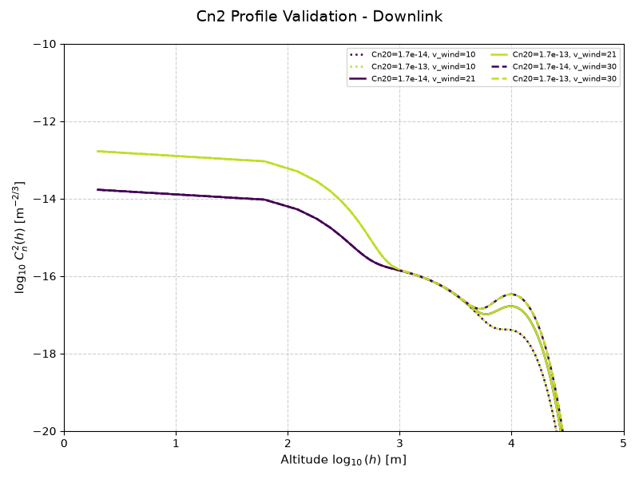 
      <b>(a) QDL-FSO implementation</b>
    </td>
    <td width="50%" align="center">
      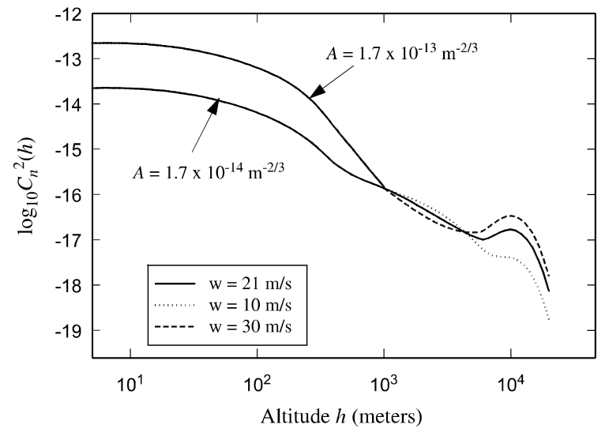 
      <b>(b) Reference</b>
    </td>
  </tr>
</table>

$C_n^2(h)$ *profile for the downlink scenario.*

### Uplink Scenario

<table width="100%">
  <tr>
    <td width="50%" align="center">
      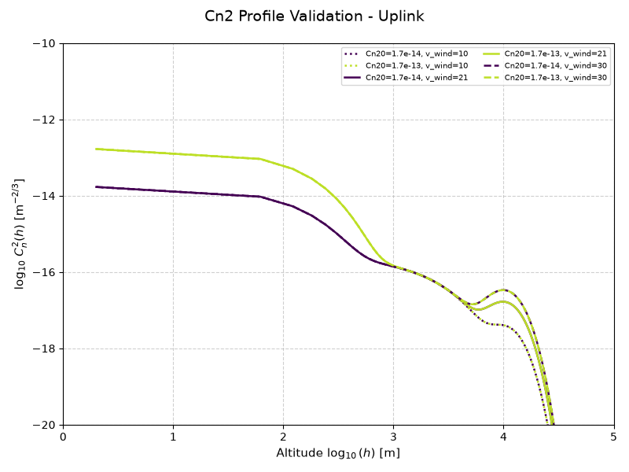 
      <b>(a) QDL-FSO implementation</b>
    </td>
    <td width="50%" align="center">
       
      <b>(b) Reference</b>
    </td>
  </tr>
</table>

$C_n^2(h)$ *profile for the uplink scenario.*

The uplink and downlink plots are identical because $C_n^2(h)$ depends only on altitude, regardless of the propagation direction. Both cases are included to verify that the implementation yields consistent $C_n^2(h)$ profiles for uplink and downlink scenarios.

---

## Rytov and Beam-Wander Variance

The Rytov variance characterizes the strength of irradiance fluctuations induced by atmospheric turbulence. 
The beam-wander variance quantifies the large-scale transverse displacement of the beam centroid caused by turbulent refraction.

Both quantities are evaluated for downlink, uplink, and horizontal propagation. 
The vertical scenarios use a ground terminal at $2\text{ m}$ and a second terminal extending to approximately $600\text{ km}$, with a zero zenith angle. The horizontal path length ranges from $100\text{ m}$ to $3\text{ km}$.

For each geometry, the wind speed and ground-level $C_n^2(0)$ are varied over the same grids used in the HV validation.
These sweeps check the numerical behaviour of the models across different path lengths and turbulence conditions.

  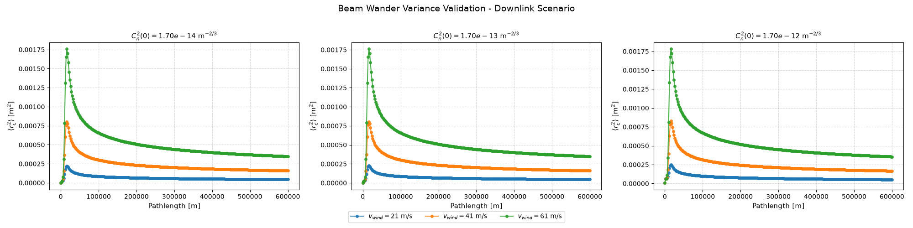 
  <i>Beam-wander variance for downlink propagation.</i>

  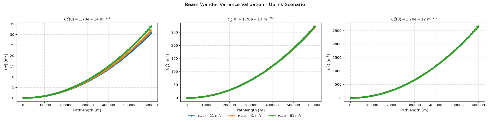 
  <i>Beam-wander variance for uplink propagation.</i>

  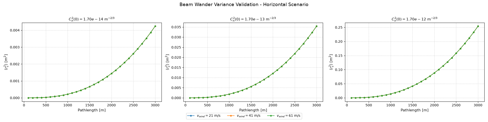 
  <i>Beam-wander variance for horizontal propagation.</i>

---

## Geometric Pointing Error

The geometric pointing-error model accounts for power loss due to transverse displacement between the beam and the receiver aperture.
The validation considers the Farid and Miao formulations, comparing the resulting pointing-efficiency curves with the corresponding published reference plots (Figs. 5 and 8 of Miao *et al.*, *New Results for the Pointing Errors Model in Two Asymptotic Cases*).

The comparison covers downlink, uplink, and horizontal geometries.

### Farid Model

<table width="100%">
  <tr>
    <td width="50%" align="center">
      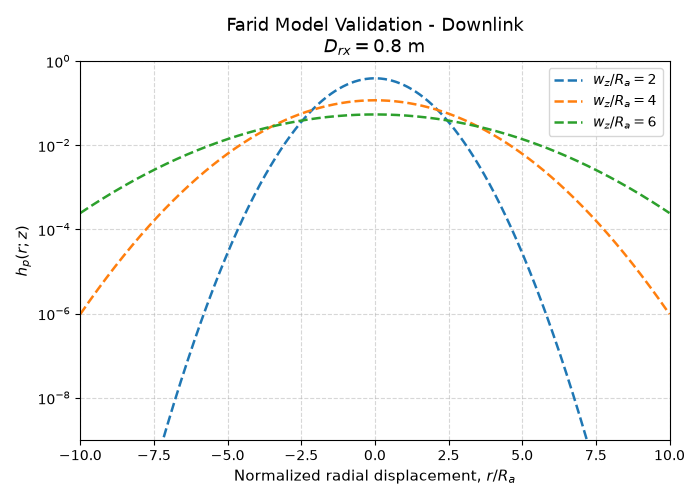 
      <b>(a) QDL-FSO implementation</b>
    </td>
    <td width="50%" align="center">
      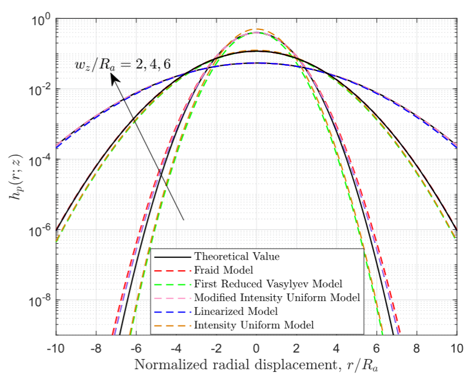 
      <b>(b) Reference</b>
    </td>
  </tr>
</table>

*Farid pointing-efficiency model for downlink propagation.*

<table width="100%">
  <tr>
    <td width="50%" align="center">
      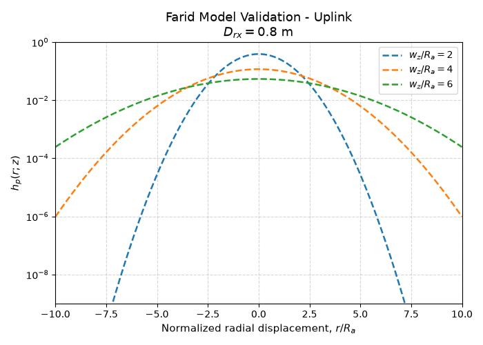 
      <b>(a) QDL-FSO implementation</b>
    </td>
    <td width="50%" align="center">
       
      <b>(b) Reference</b>
    </td>
  </tr>
</table>

*Farid pointing-efficiency model for uplink propagation.*

<table width="100%">
  <tr>
    <td width="50%" align="center">
      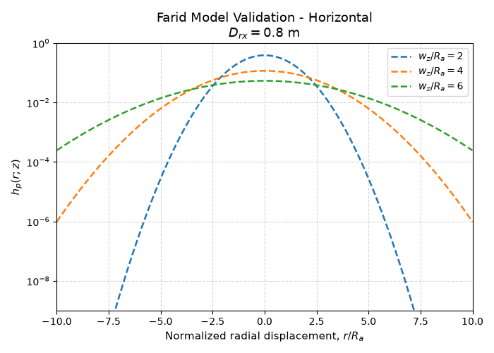 
      <b>(a) QDL-FSO implementation</b>
    </td>
    <td width="50%" align="center">
       
      <b>(b) Reference</b>
    </td>
  </tr>
</table>

*Farid pointing-efficiency model for horizontal propagation.*

### Miao Model

<table width="100%">
  <tr>
    <td width="50%" align="center">
      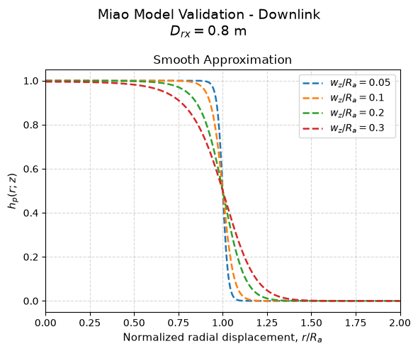 
      <b>(a) QDL-FSO implementation</b>
    </td>
    <td width="50%" align="center">
      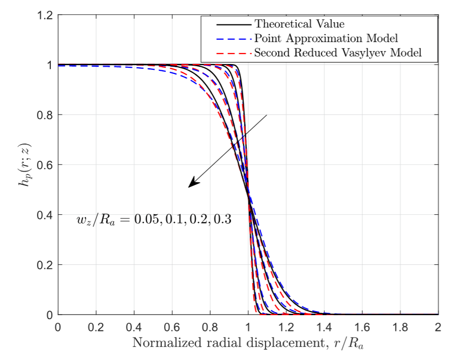 
      <b>(b) Reference</b>
    </td>
  </tr>
</table>

*Miao pointing-efficiency model for downlink propagation.*

<table width="100%">
  <tr>
    <td width="50%" align="center">
      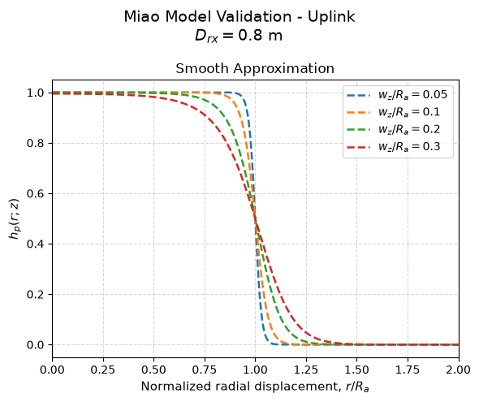 
      <b>(a) QDL-FSO implementation</b>
    </td>
    <td width="50%" align="center">
       
      <b>(b) Reference</b>
    </td>
  </tr>
</table>

*Miao pointing-efficiency model for uplink propagation.*

<table width="100%">
  <tr>
    <td width="50%" align="center">
      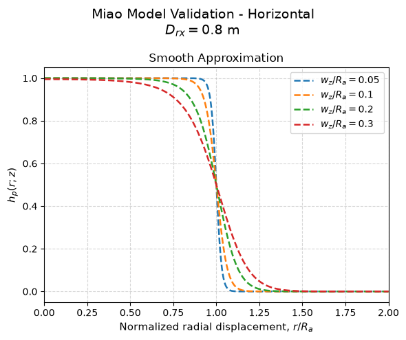 
      <b>(a) QDL-FSO implementation</b>
    </td>
    <td width="50%" align="center">
       
      <b>(b) Reference</b>
    </td>
  </tr>
</table>

*Miao pointing-efficiency model for horizontal propagation.*

### Radial Displacement Statistics

The random radial displacement is also validated independently of the pointing-efficiency curves. For isotropic, zero-mean Gaussian transverse displacement components with equal variance, the radial displacement $r$ follows a Rayleigh distribution:

$$
f_R(r) = \frac{r}{\sigma^2} \exp\left(-\frac{r^2}{2\sigma^2}\right), \qquad r\geq 0
$$

where $\sigma^2$ is the variance of either Cartesian displacement component.

The empirical Monte Carlo distribution is compared with the analytical Rayleigh probability density for each propagation geometry.
This provides an independent check of the displacement sampling procedure.

  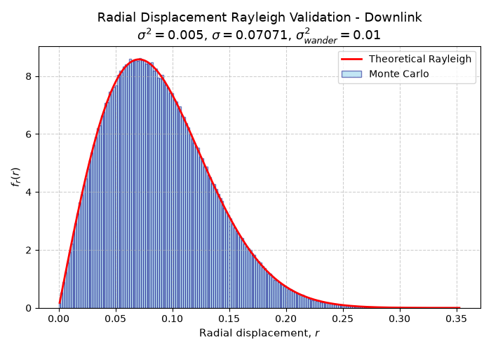 
  <i>Empirical and analytical radial-displacement distributions for downlink.</i>

   
  <i>Empirical and analytical radial-displacement distributions for uplink.</i>

  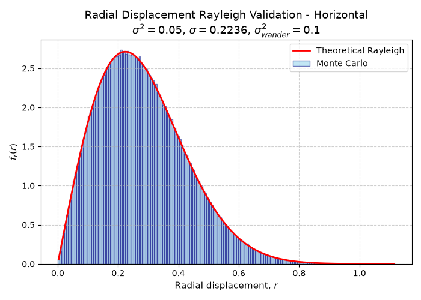 
  <i>Empirical and analytical radial-displacement distributions for horizontal propagation.</i>

The limiting case of unit tracking efficiency is also checked: when tracking is perfect, the radial displacement must be zero.

---

## Gamma-Gamma Scintillation

Atmospheric scintillation is modelled using the Gamma-Gamma distribution, which represents irradiance fluctuations due to small- and large-scale turbulence effects.
The model is tested over weak, moderate, and strong turbulence conditions.

For downlink, the selected Rytov variances are $0.1$, $2$, and $25$; for uplink, they are $0.06$, $2$, and $5$.
Monte Carlo irradiance samples are compared with the theoretical probability density functions (PDFs).
The comparison is performed for standardized log-irradiance, following Sections 9.10.1 and 9.10.2 of Andrews and Phillips, *Laser Beam Propagation through Random Media*.

For raw irradiance, the MAE between the empirical histogram and theoretical PDF is required to be below $0.03$.

### Downlink

<table width="100%">
  <tr>
    <td width="50%" align="center">
      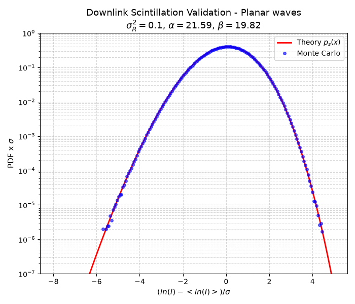 
      <b>(a) QDL-FSO implementation</b>
    </td>
    <td width="50%" align="center">
      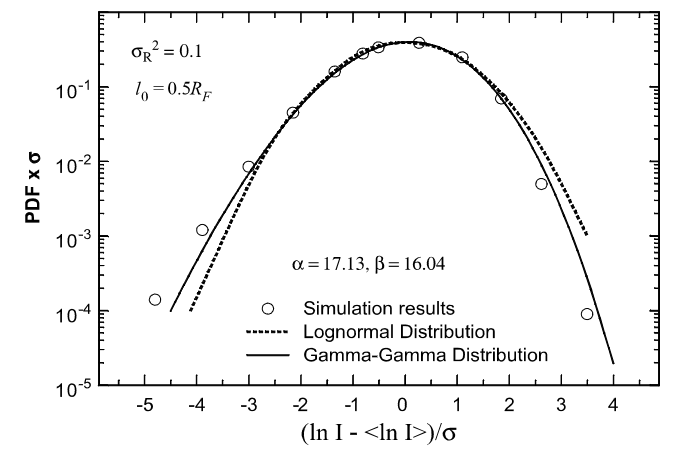 
      <b>(b) Reference</b>
    </td>
  </tr>
</table>

*Gamma-Gamma scintillation for downlink with Rytov variance* $0.1$*.*

<table width="100%">
  <tr>
    <td width="50%" align="center">
      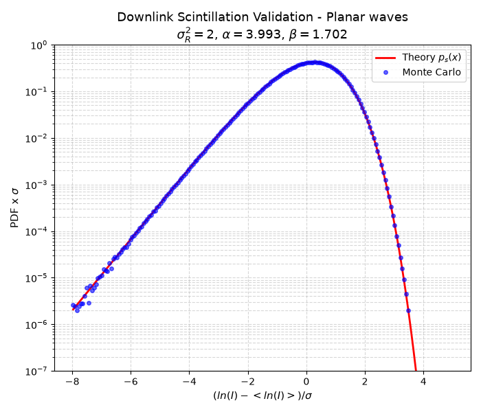 
      <b>(a) QDL-FSO implementation</b>
    </td>
    <td width="50%" align="center">
      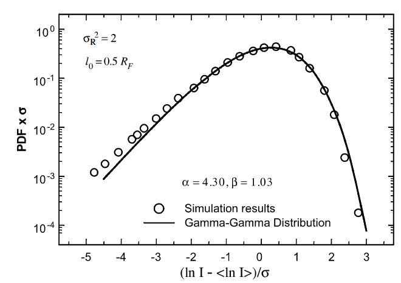 
      <b>(b) Reference</b>
    </td>
  </tr>
</table>

*Gamma-Gamma scintillation for downlink with Rytov variance* $2$*.*

<table width="100%">
  <tr>
    <td width="50%" align="center">
      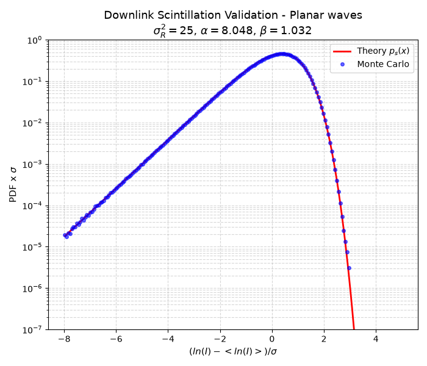 
      <b>(a) QDL-FSO implementation</b>
    </td>
    <td width="50%" align="center">
      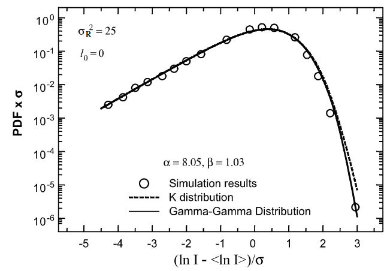 
      <b>(b) Reference</b>
    </td>
  </tr>
</table>

*Gamma-Gamma scintillation for downlink with Rytov variance* $25$*.*

### Uplink

<table width="100%">
  <tr>
    <td width="50%" align="center">
      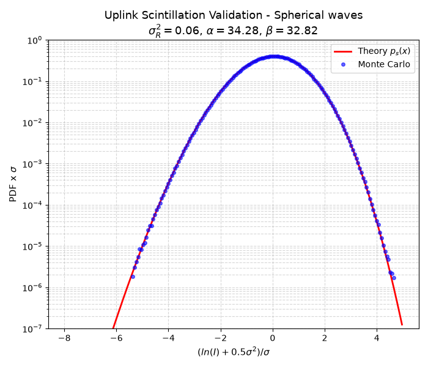 
      <b>(a) QDL-FSO implementation</b>
    </td>
    <td width="50%" align="center">
      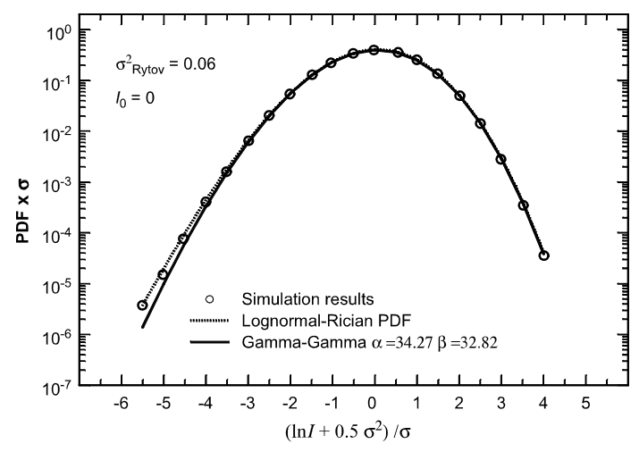 
      <b>(b) Reference</b>
    </td>
  </tr>
</table>

*Gamma-Gamma scintillation for uplink with Rytov variance* $0.06$*.*

<table width="100%">
  <tr>
    <td width="50%" align="center">
      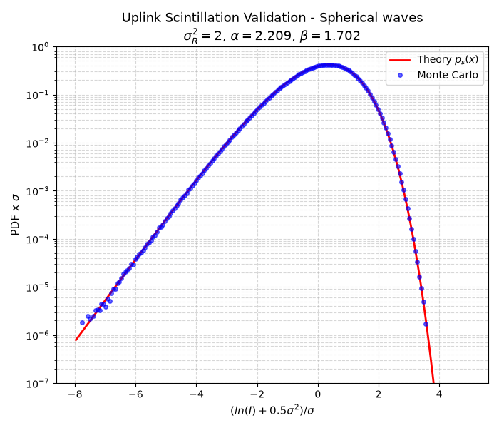 
      <b>(a) QDL-FSO implementation</b>
    </td>
    <td width="50%" align="center">
      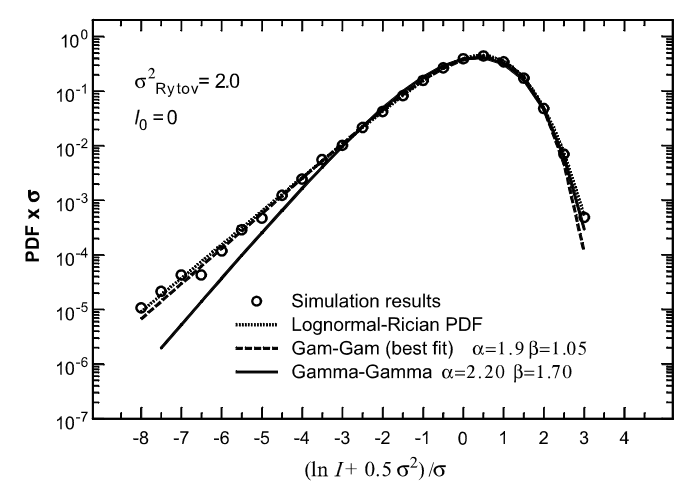 
      <b>(b) Reference</b>
    </td>
  </tr>
</table>

*Gamma-Gamma scintillation for uplink with Rytov variance* $2$*.*

<table width="100%">
  <tr>
    <td width="50%" align="center">
      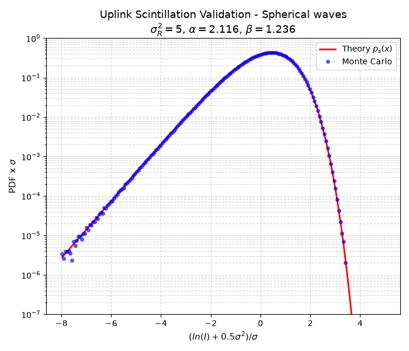 
      <b>(a) QDL-FSO implementation</b>
    </td>
    <td width="50%" align="center">
      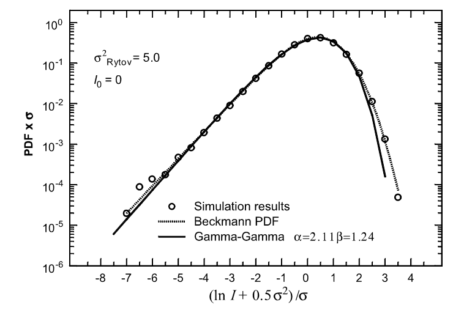 
      <b>(b) Reference</b>
    </td>
  </tr>
</table>

*Gamma-Gamma scintillation for uplink with Rytov variance* $5$*.*

---

## Atmospheric Attenuation

The Kim, Kruse, and LOWTRAN models are first compared using the same visibility parameter ($5\text{ km}$) to verify that the three models are consistent with each other.
For LOWTRAN, the "Tropical" atmospheric model and the "Urban $5\text{ km}$" visibility aerosol type are selected, since this combination closely matches the Kim model.

  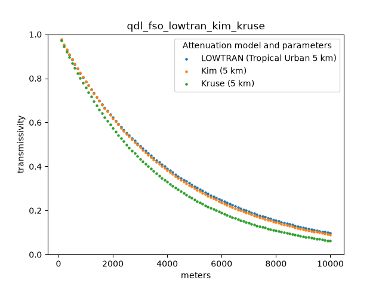 
  <i>Comparison between Kim, Kruse and LOWTRAN models with 5 km visibility.</i>

The remaining tests check that the LOWTRAN implementation behaves sensibly across the full range of input parameters that can be provided: atmospheric model, aerosol type, wind speed, average wind speed, air mass character, zenith angle, and volcanic profile.
The goal is to confirm that each parameter is correctly handled and actually affects the computed transmissivity, rather than being silently ignored.
This is needed because the reference LOWTRAN implementation we build upon (the Python module by M. Hirsch, [doi:10.5281/zenodo.213475](https://doi.org/10.5281/zenodo.213475)) only handled a subset of these parameters, so some of them were added and exposed as part of this work.

  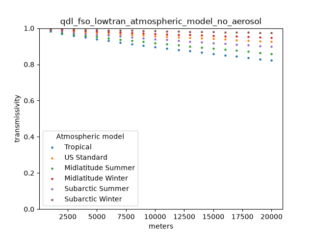 
  <i>Comparison between atmospheric models on horizontal links without aerosol.</i>

  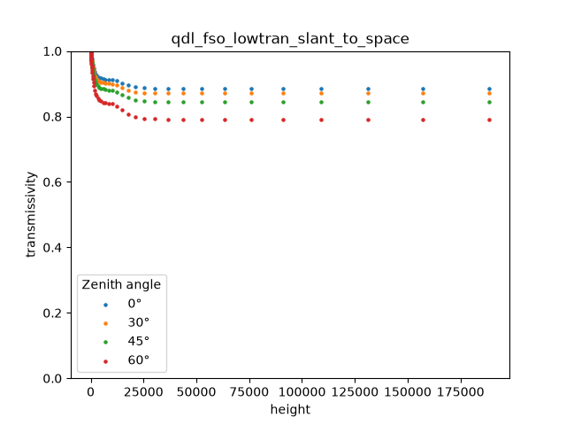 
  <i>Comparison between slant paths with different zenith angles.</i>

  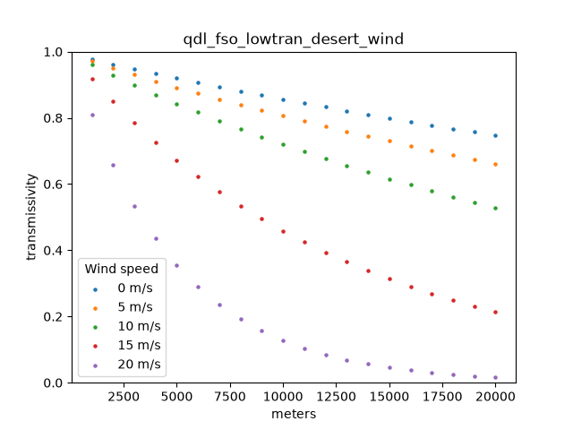 
  <i>Comparison between horizontal links with different wind speeds (Desert aerosol type).</i>

  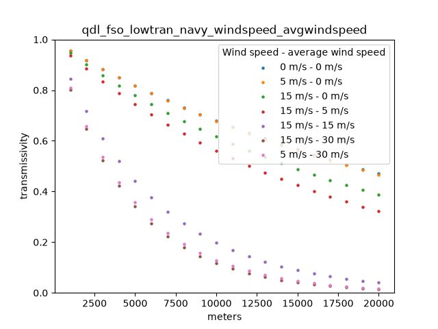 
  <i>Comparison between horizontal links with different wind speeds (Maritime Navy aerosol type).</i>

  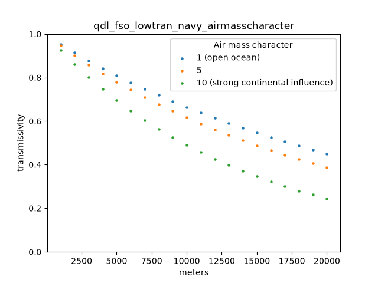 
  <i>Comparison between horizontal links with different air mass character (Maritime Navy aerosol type).</i>

  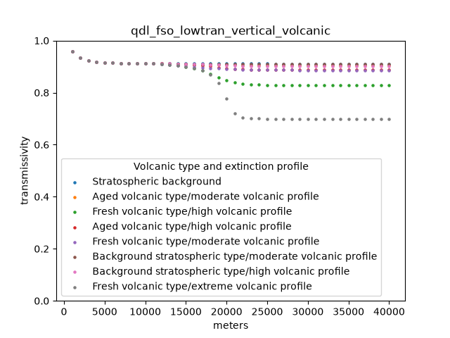 
  <i>Comparison between vertical paths with different volcanic aerosol types and extinction profiles.</i>

